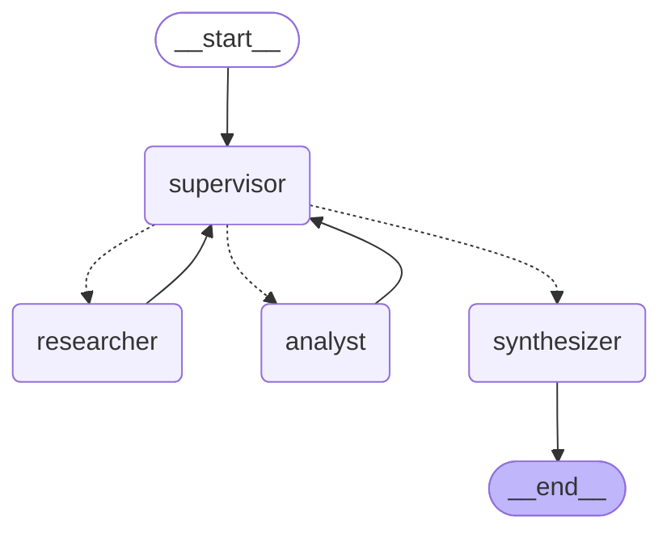

# Pre-entrega 6: Orquestador multi-agente especializado

Prototipo de un orquestador jerárquico en **LangGraph**. Un nodo `supervisor` actúa como router y puerta de calidad: delega en un **investigador** y en un **analista**, valida sus salidas con una rúbrica y cierra con una fase de **síntesis** final.

## Topología



El mismo diagrama está en `docs/graph.mmd` (fuente) y `docs/graph.png`. Se regenera con `graph.get_graph().draw_mermaid()` / `draw_mermaid_png()` (ver `export_diagram` en `src/graph.py`).

### Por qué esta topología

- **Hub-and-spoke (supervisor central):** todo el flujo pasa por un único punto de decisión. Es fácil de depurar, de auditar y de extender: agregar un especialista es un nodo más y una opción más en el `Literal`.
- **Los especialistas nunca hablan entre sí.** Siempre vuelven al supervisor, que es el único que decide el siguiente paso. Así no hay conflictos de turno ni dependencias circulares entre agentes.
- **Síntesis separada:** el supervisor decide *cuándo* terminar y un nodo `synthesizer` redacta la respuesta final solo con las contribuciones registradas.

### Cómo se manejan los conflictos y los bucles

| Riesgo | Mitigación |
|---|---|
| "Supervisor infinito" | `step_count` con tope `MAX_STEPS = 6`, máximo `MAX_VISITS_PER_AGENT = 2` activaciones por especialista (pasada inicial + un refinamiento) y `recursion_limit` de LangGraph como red de seguridad. |
| El LLM del supervisor ignora las reglas | `apply_guardrails` (código determinista) corrige la decisión: rechaza `FINISH` hasta que contribuyan los dos dominios, impide analizar antes de investigar y fuerza la síntesis al agotar el presupuesto. |
| Calidad de las salidas | Rúbrica explícita en el prompt del supervisor (cobertura, evidencia, cuantificación, fundamentación, suficiencia). Si un criterio falla, devuelve el trabajo **una sola vez** indicando qué corregir. |
| Contaminación de contexto | Cada especialista recibe solo su instrucción y el contexto necesario (el analista ve los hallazgos del investigador), no el historial completo. |
| Pérdida de procedencia | `contributions` guarda quién aportó qué, en qué decisión y con qué instrucción. |

## Estado compartido (`src/state.py`)

`OrchestratorState` hereda de `MessagesState` y agrega: `task`, `next_agent`, `instructions`, `supervisor_reasoning`, `contributions` (lista de `Contribution` con reducer de concatenación), `step_count`, `visits` (reducer de merge), `task_completed` y `final_answer`.

## Componentes

| Archivo | Qué hace |
|---|---|
| `src/state.py` | Esquema de estado compartido y reducers. |
| `src/config.py` | Variables de entorno, rutas, límites de parada y fábrica del LLM Gemini. |
| `src/supervisor.py` | Nodo `supervisor` (decisión estructurada + guardarraíles), router condicional y nodo `synthesizer`. |
| `src/agents/research_agent.py` | Agente investigador (ReAct con `create_agent`). |
| `src/agents/analyst_agent.py` | Agente analista (ReAct con `create_agent`). |
| `src/agents/common.py` | Envoltorio que aísla el contexto de cada especialista y registra su `Contribution`. |
| `src/tools/research_tools.py` | `search_knowledge_base` (búsqueda local) y, si hay `TAVILY_API_KEY`, `TavilySearch`. |
| `src/tools/analysis_tools.py` | `analyze_sentiment`, `compute_statistics`, `calculate` (aritmética segura sin `eval`). |
| `src/graph.py` | Construcción del `StateGraph`, estado inicial y exportación del diagrama. |
| `src/main.py` | CLI: ejecuta el flujo, imprime la traza de delegación y la guarda en `logs/last_run.md`. |
| `data/knowledge_base.json` | Base de conocimiento de **muestra** (opiniones ficticias sobre LangGraph, CrewAI y AutoGen). |
| `tests/` | 19 pruebas offline, incluido el flujo completo con un LLM simulado. |
| `notebooks/demo.ipynb` | Demo del flujo de delegación. |

## Stack

Python 3.12, LangGraph, LangChain (`create_agent`), `langchain-google-genai` (Gemini, modelo `gemini-3.5-flash-lite` por defecto), `langchain-tavily` (opcional), `python-dotenv`, `pytest`.

## Cómo levantar el entorno (PowerShell)

```powershell
cd "C:\Users\Gonzalo\Desktop\Gonza\Cursos\Coderhouse AI Engineering\pre-entrega-6"
py -3.12 -m venv .venv
Set-ExecutionPolicy -Scope Process -ExecutionPolicy RemoteSigned
.\.venv\Scripts\Activate.ps1
pip install -r requirements.txt
Copy-Item .env.example .env
```

Editá `.env` y completá `GOOGLE_API_KEY` (obligatoria), `MODEL_NAME` (opcional, por defecto `gemini-3.5-flash-lite`) y `TAVILY_API_KEY` (opcional: habilita la búsqueda web).

## Ejecución

Todo se corre desde la raíz del proyecto, como módulo:

```powershell
python -m pytest -q                 # pruebas offline (no necesitan API key)
python -m src.main                  # consulta de demostración
python -m src.main "tu consulta"    # consulta propia
python -m src.graph                 # regenera docs/graph.mmd y docs/graph.png
```

Para ver el flujo paso a paso, también se puede abrir `notebooks/demo.ipynb`.

## Resultados

- **Pruebas offline:** `python -m pytest -q` → `19 passed`. Cubren las herramientas, los guardarraíles y tres escenarios del grafo con un LLM simulado: camino feliz (supervisor → investigador → supervisor → analista → supervisor → síntesis), un supervisor terco que pide siempre al investigador (termina igual por los topes) y un `FINISH` prematuro que se rechaza.
- **Corrida real con Gemini:** _pendiente de completar_. Ejecutá `python -m src.main` y pegá aquí el contenido de `logs/last_run.md` (la traza de delegación).

## Checklist de la consigna

- [x] `state.py` con esquema compartido que hereda de `MessagesState`
- [x] Carpeta de agentes con investigador y analista, cada uno con herramientas acotadas
- [x] Nodo `Supervisor` con `Literal` en el router de las aristas condicionales
- [x] Rúbrica de validación en el prompt del supervisor antes del `END`
- [x] Condición de parada (contador de pasos, tope de refinamientos, `recursion_limit`)
- [x] Fase de síntesis final
- [x] README con diagrama Mermaid, justificación de la topología y manejo de conflictos
- [x] Herramientas funcionales (búsqueda local, Tavily opcional, sentimiento, estadística, cálculo)
- [ ] Demostración (notebook ejecutado o video) con corrida real
- [ ] Repositorio público en GitHub
